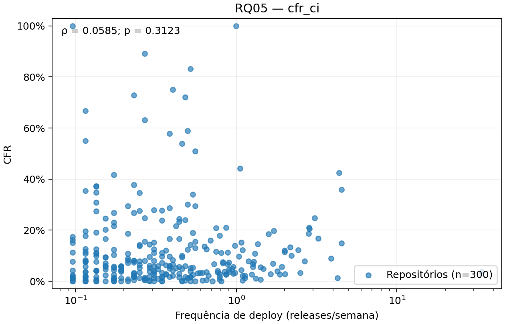
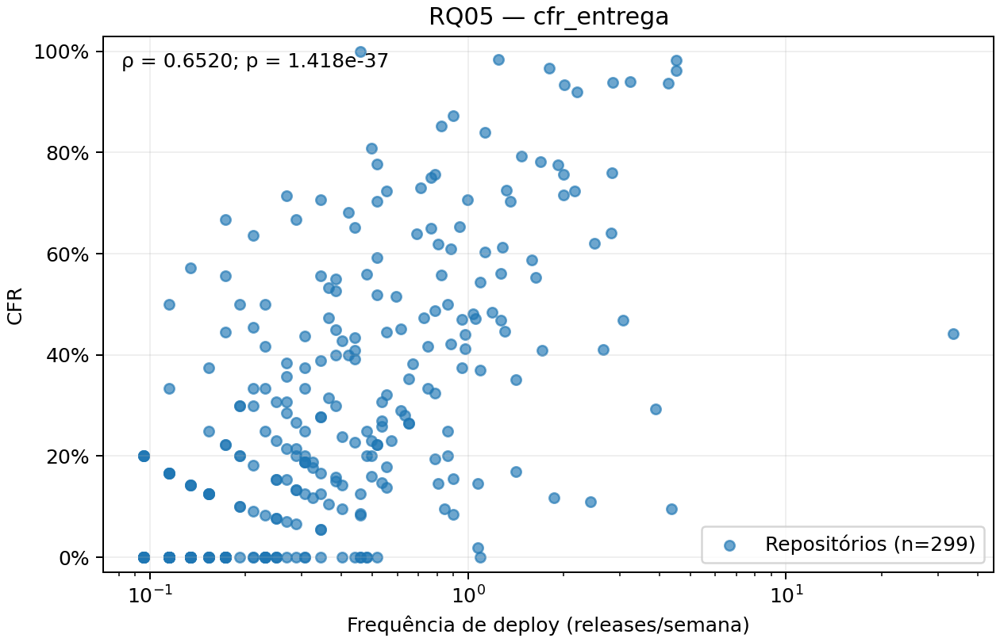

# 3. Resultados

> Rascunho em Markdown da seção de Resultados (Lab03S03, Issue #51). A versão final vai para o template SBC.
> Divisão: A → RQ 01 a RQ 04 e classificação C1 (#48) · B → RQ 05 (#46) e RQ 06 (#47) · C → RQ 07 (#49) e RQ 08 (#50). Revisão pelos três.
> Todo número vem de um arquivo de `output/analises/`; os números das RQ 01 a 04 vêm de `output/analises/rq01_rq04/` sobre `output/metricas_repos.csv` (#35). Nenhum valor é digitado sem a saída correspondente.

Todas as métricas são resumidas por mediana e intervalo interquartil (IQR), calculados sobre os repositórios com valor; a quantidade de repositórios sem valor é informada em cada tabela. As tabelas e figuras desta seção para as RQ 01 a RQ 04 são geradas por `python -m analises.rq01_rq04 --config config.yaml` (`output/analises/rq01_rq04/`).

## 3.1 RQ 01: frequência de deploys

| Métrica | n | Mediana | Q1 | Q3 | IQR | Mínimo | Máximo |
| --- | ---: | ---: | ---: | ---: | ---: | ---: | ---: |
| Frequência (releases/semana) | 300 | 0,35 | 0,17 | 0,70 | 0,52 | 0,10 | 33,64 |

A mediana é de 0,35 release por semana, cerca de 1,5 release por mês. Metade dos repositórios publica entre 0,17 e 0,70 release por semana (de 0,7 a 3 releases por mês). A distribuição é fortemente assimétrica à direita: só 46 repositórios (15,3 %) publicam ao menos uma release por semana, e o máximo, `bluesky-social/atproto`, publicou 1.754 releases na janela (33,6 por semana). O mínimo, 0,10, corresponde ao piso do critério de inclusão (5 releases em 52 semanas).

Nas categorias DORA, 157 repositórios (52,3 %) são Medium, 97 (32,3 %) Low, 45 (15,0 %) High e apenas 1 (0,3 %) Elite (`bluesky-social/atproto`). A Figura `rq01_frequencia.png` mostra a distribuição com os cortes das categorias.

## 3.2 RQ 02: lead time

| Variante | n | Mediana (h) | Q1 (h) | Q3 (h) | IQR (h) | Mínimo (h) | Máximo (h) |
| --- | ---: | ---: | ---: | ---: | ---: | ---: | ---: |
| (a) por release | 300 | 187,51 | 25,71 | 840,06 | 814,35 | 0,00 | 83.120,66 |
| (b) por commit | 300 | 188,55 | 34,09 | 677,05 | 642,96 | 0,01 | 56.327,19 |

As medianas das duas variantes são praticamente iguais, cerca de 7,8 dias (a) e 7,9 dias (b), pouco acima do corte de uma semana entre High e Medium. A dispersão é menor na variante (b): o intervalo interquartil vai de 1,1 a 35,0 dias em (a) e de 1,4 a 28,2 dias em (b). As duas distribuições têm cauda longa: o máximo, `phpseclib/phpseclib`, passa de 9 anos em (a) e de 6 anos em (b).

Comparando repositório a repositório, o lead time por commit (b) é menor que o por release (a) em 183 dos 300 repositórios (61,0 %), igual em 1 e maior em 116. A mediana da razão (b)/(a) é 0,72. A Figura `rq02_lead_time.png` mostra as duas variantes em escala logarítmica.

## 3.3 RQ 03: taxa de falha das mudanças

| Variante | n | Ausentes | Mediana | Q1 | Q3 | IQR |
| --- | ---: | ---: | ---: | ---: | ---: | ---: |
| (a) proxy de CI | 300 | 0 | 6,05 % | 2,47 % | 14,31 % | 11,83 % |
| (b) proxy de entrega | 299 | 1 | 20,00 % | 0,00 % | 45,31 % | 45,31 % |

As duas variantes contam histórias diferentes. No proxy de CI (a), a mediana é de 6,05 % de execuções com falha, e 228 repositórios (76,0 %) ficam na faixa Elite (≤ 15 %). No proxy de entrega (b), a mediana é de 20,0 %, e a dispersão é muito maior.

No CFR (b), foram avaliadas 10.796 releases, das quais 4.979 (46,1 % no agregado) foram seguidas por uma release corretiva em até 7 dias; 292 releases, publicadas nos últimos 7 dias da janela, foram censuradas. Um repositório não tem CFR (b) porque todas as suas releases foram censuradas. O dataset foi regenerado com a v3, que obteve precisão de 0,6818, recall de 0,7282 e F1 de 0,7042 na validação da #34 (Seção 2.7). A mediana de CFR (b) caiu de 40,0 % no dataset com a v1 para 20,0 % com a v3; as métricas de CI, frequência, lead time e recuperação permaneceram idênticas. A Figura `rq03_cfr.png` compara as duas variantes.

## 3.4 RQ 04: tempo de recuperação

| Métrica | n | Ausentes | Mediana (h) | Q1 (h) | Q3 (h) | IQR (h) | Máximo (h) |
| --- | ---: | ---: | ---: | ---: | ---: | ---: | ---: |
| Tempo de recuperação | 272 | 28 | 4,19 | 0,95 | 21,51 | 20,56 | 3.958,31 |

A mediana do tempo de recuperação é de 4,2 horas, e metade dos repositórios se recupera entre 1 hora e 21,5 horas. Foram observados 9.862 episódios de falha. Só 1,32 % deles foram censurados, isto é, não tiveram sucesso até o fim da janela e entram na mediana com o tempo decorrido até lá; a mediana da proporção censurada por repositório é zero; 80 repositórios têm ao menos um episódio censurado. Os 28 repositórios sem nenhum episódio ficam sem valor nesta métrica: em 19 deles, nenhuma execução válida falhou na janela.

A Figura `rq04_recuperacao.png` mostra a distribuição em escala logarítmica, com os cortes DORA.

## 3.5 Classificação DORA de referência (C1)

A combinação C1 usa a release publicada como unidade de deploy, o lead time por release (a) e o CFR por proxy de CI (a), além do tempo de recuperação. Cada repositório recebe uma categoria por métrica e uma categoria geral (mediana dos pontos, arredondada para baixo, com no mínimo três métricas com valor).

| Categoria | Frequência | Lead time (a) | CFR (a) | Recuperação | Geral |
| --- | ---: | ---: | ---: | ---: | ---: |
| Elite | 1 (0,3 %) | 72 (24,0 %) | 228 (76,0 %) | 72 (24,0 %) | 24 (8,0 %) |
| High | 45 (15,0 %) | 75 (25,0 %) | 45 (15,0 %) | 139 (46,3 %) | 126 (42,0 %) |
| Medium | 157 (52,3 %) | 71 (23,7 %) | 13 (4,3 %) | 38 (12,7 %) | 115 (38,3 %) |
| Low | 97 (32,3 %) | 82 (27,3 %) | 14 (4,7 %) | 23 (7,7 %) | 35 (11,7 %) |
| Sem classificação | 0 | 0 | 0 | 28 (9,3 %) | 0 |

Na categoria geral, 126 repositórios (42,0 %) são High, 115 (38,3 %) Medium, 35 (11,7 %) Low e 24 (8,0 %) Elite (Figura `c1_distribuicao.png`). Todos os 300 recebem categoria geral: 272 com as quatro métricas e 28 com três (sem tempo de recuperação). A classificação calculada aqui coincide, nos 300 repositórios e nas cinco colunas, com a gravada no dataset da #35, que foi implementada de forma independente.

## 3.6 RQ 05: frequência de deploy × taxa de falha

A análise usa o dataset de 300 repositórios, com pares completos selecionados separadamente para cada variante, sem imputação. A Tabela abaixo foi obtida de `output/analises/rq05/correlacoes.csv` pelo teste bilateral de Spearman (SciPy 1.14.1); os coeficientes e p-valores completos estão preservados no CSV.

| Variante de CFR | n | Excluídos | ρ de Spearman | p-valor aproximado |
| --- | ---: | ---: | ---: | ---: |
| (a) proxy de CI | 300 | 0 | 0,0585 | 0,3123 |
| (b) proxy de entrega | 299 | 1 | 0,6520 | 1,4183 × 10⁻³⁷ |

Não houve frequência ausente. O repositório `egoist/mygo` foi excluído somente da variante (b), por ausência de CFR de entrega: todas as suas releases foram censuradas no dataset. Os pares e a exclusão constam de `pares.csv` e `exclusoes.csv`. O CFR (b) foi recalculado com a v3, validada na #34 (F1 = 0,7042). As limitações do refinamento e da avaliação na mesma amostra-ouro são consideradas na discussão.

As figuras apresentam a frequência em releases/semana em escala logarítmica (todas as frequências são positivas) e o CFR em percentual. A transformação é apenas visual: Spearman usa os postos dos valores originais.

## 3.7 RQ 06: características associadas ao desempenho

Foram analisados quatro fatores (estrelas, contribuidores, idade e tipo de projeto) e seis variantes de métricas, em uma família de 24 testes corrigida por Holm (α = 0,05). Todos os testes foram viáveis e usaram Kruskal-Wallis, pois os fatores têm quatro grupos. O suporte a dois grupos usa Mann-Whitney e δ de Cliff, mas não foi acionado nesta amostra. Os fatores numéricos têm quatro grupos de 75 repositórios, definidos antes das exclusões por métrica. Tipo de projeto tem 60 repositórios: 20 aplicações/serviços, 25 bibliotecas/frameworks, 8 ferramentas CLI e 7 de outros tipos; os demais 240 são excluídos apenas desse fator.

Os quartis e seus membros estão em `output/analises/rq06/limites_grupos.csv` e `agrupamentos.csv`. Não há empates separados pela ordem dos repositórios; cortes repetidos seriam removidos. Os intervalos numéricos são abertos à esquerda e fechados à direita, exceto o primeiro, que inclui o mínimo.

A família contém 13 testes com p bruto < 0,05 e 8 após Holm. A tabela apresenta os que permanecem significativos; os 24 testes completos, com p bruto, p corrigido, n e efeito ε² = H/(n−1), estão em `testes.csv` e `relatorio.md`.

| Fator | Métrica | n | H | p bruto | p Holm | ε² |
| --- | --- | ---: | ---: | ---: | ---: | ---: |
| Estrelas | Lead time (a) | 300 | 14,522 | 0,0023 | 0,0387 | 0,049 |
| Contribuidores | Lead time (a) | 300 | 70,535 | 3,278e-15 | 7,539e-14 | 0,236 |
| Contribuidores | Lead time (b) | 300 | 43,224 | 2,206e-09 | 4,192e-08 | 0,145 |
| Contribuidores | CFR (b) | 299 | 30,126 | 1,299e-06 | 2,338e-05 | 0,101 |
| Idade | Frequência | 300 | 44,602 | 1,124e-09 | 2,248e-08 | 0,149 |
| Idade | Lead time (a) | 300 | 74,217 | 5,333e-16 | 1,280e-14 | 0,248 |
| Idade | Lead time (b) | 300 | 55,854 | 4,514e-12 | 9,479e-11 | 0,187 |
| Idade | CFR (b) | 299 | 69,206 | 6,313e-15 | 1,389e-13 | 0,232 |

A tabela seguinte seleciona descritivas para confrontar as hipóteses. Cada célula é mediana (IQR); frequência em releases/semana e lead time em horas. Todos esses grupos têm 75 observações nessas duas métricas. As descritivas completas, com n válido, ausências, Q1 e Q3 de cada grupo e variante, estão em `descritivas.csv` e no relatório.

| Fator | Grupo | Frequência: mediana (IQR) | Lead time (a): mediana (IQR) |
| --- | --- | ---: | ---: |
| Contribuidores | Q1 | 0,44 (0,65) | 23,44 (103,36) |
| Contribuidores | Q2 | 0,27 (0,57) | 146,50 (644,97) |
| Contribuidores | Q3 | 0,35 (0,42) | 280,64 (834,69) |
| Contribuidores | Q4 | 0,31 (0,36) | 753,91 (1709,79) |
| Idade | Q1 | 0,65 (0,84) | 25,93 (68,54) |
| Idade | Q2 | 0,35 (0,60) | 169,29 (511,65) |
| Idade | Q3 | 0,29 (0,32) | 341,28 (805,42) |
| Idade | Q4 | 0,21 (0,25) | 793,12 (2014,69) |

Na recuperação, os fatores numéricos usam 272 repositórios e o tipo de projeto usa 57; os demais não possuem valor da métrica. CFR (b) usa 299 nos fatores numéricos e 60 por tipo. Nenhum grupo usado no teste ficou com menos de cinco observações. As exclusões são registradas por fator × métrica em `exclusoes.csv`, sem imputação. As associações que usam CFR (b) foram recalculadas com a v3, validada na #34; toda a família de Holm foi reavaliada, inclusive os p-valores corrigidos das outras métricas.

## 3.8 RQ 07: sensibilidade à definição operacional

As três combinações (C1, C2 e C3, definidas na Seção 2.6) foram comparadas par a par por `python -m analises.rq07_sensibilidade --config config.yaml` (`output/analises/rq07/`). Todos os 300 repositórios receberam categoria geral nas três combinações, então nenhum foi excluído dos pares.

| Unidade de deploy | n | Mediana (por semana) | Q1 | Q3 | IQR |
| --- | ---: | ---: | ---: | ---: | ---: |
| Release (C1) | 300 | 0,35 | 0,17 | 0,70 | 0,52 |
| Release + pré-release (C2) | 300 | 0,38 | 0,19 | 0,82 | 0,63 |
| Tag (C3) | 300 | 0,47 | 0,21 | 0,93 | 0,72 |

| Categoria geral | C1 | C2 | C3 |
| --- | ---: | ---: | ---: |
| Elite | 24 (8,00 %) | 5 (1,67 %) | 21 (7,00 %) |
| High | 126 (42,00 %) | 89 (29,67 %) | 135 (45,00 %) |
| Medium | 115 (38,33 %) | 175 (58,33 %) | 121 (40,33 %) |
| Low | 35 (11,67 %) | 31 (10,33 %) | 23 (7,67 %) |
| Sem classificação | 0 (0,00 %) | 0 (0,00 %) | 0 (0,00 %) |

| Par | Comparados | Excluídos | Mudaram | Melhoraram | Pioraram | Adjacentes | Saltos | κ ponderado | Interpretação |
| --- | ---: | ---: | ---: | ---: | ---: | ---: | ---: | ---: | --- |
| C1 × C2 | 300 | 0 | 125 (41,67 %) | 33 | 92 | 114 | 11 | 0,42 | moderada |
| C1 × C3 | 300 | 0 | 72 (24,00 %) | 44 | 28 | 71 | 1 | 0,70 | substancial |
| C2 × C3 | 300 | 0 | 98 (32,67 %) | 91 | 7 | 96 | 2 | 0,56 | moderada |

"Melhoraram" e "pioraram" comparam a categoria da segunda combinação do par com a da primeira. A maioria das mudanças é para uma categoria vizinha: 114 de 125 em C1 × C2, 71 de 72 em C1 × C3 e 96 de 98 em C2 × C3. Dos 14 saltos de duas ou mais categorias, 11 ocorrem entre C1 e C2. As matrizes de transição estão na Figura `transicao_pares.png`, e a distribuição por combinação, na Figura `distribuicao_combinacoes.png`.

| Par | Métrica | Comparados | Mudaram | Melhoraram | Pioraram |
| --- | --- | ---: | ---: | ---: | ---: |
| C1 × C2 | Frequência | 300 | 17 (5,67 %) | 17 | 0 |
| C1 × C2 | Lead time | 300 | 123 (41,00 %) | 65 | 58 |
| C1 × C2 | CFR | 299 | 196 (65,55 %) | 37 | 159 |
| C1 × C3 | Frequência | 300 | 41 (13,67 %) | 41 | 0 |
| C1 × C3 | Lead time | 300 | 123 (41,00 %) | 65 | 58 |
| C1 × C3 | CFR | 300 | 0 (0,00 %) | 0 | 0 |
| C2 × C3 | Frequência | 300 | 26 (8,67 %) | 26 | 0 |
| C2 × C3 | Lead time | 300 | 0 (0,00 %) | 0 | 0 |
| C2 × C3 | CFR | 299 | 196 (65,55 %) | 159 | 37 |

A tabela por métrica mostra de onde vem a mudança da categoria geral. A frequência só muda para melhor e em poucos repositórios (5,67 % ao incluir pré-releases e 13,67 % ao usar tags). A troca do lead time por release (a) pelo lead time por commit (b) muda a categoria de 41,00 % dos repositórios, quase metade para cada lado. A troca do CFR de CI (a) pelo CFR de entrega (b), calculado com a v3, muda a categoria de 65,55 % dos repositórios (299 com CFR (b)), e em 159 deles para pior.
